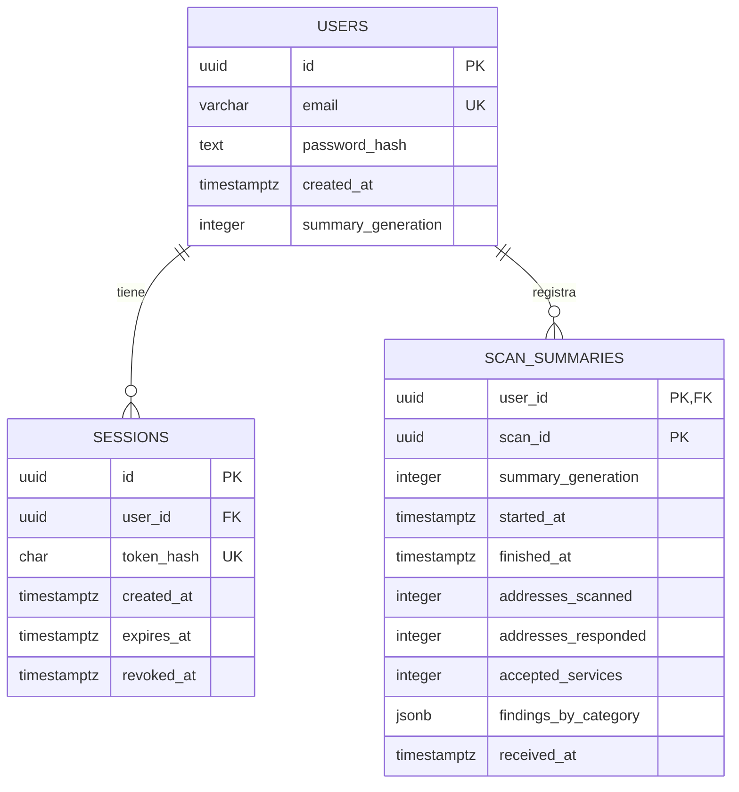

# Base de diseño del backend de HogarScan

Estado: revisión de diseño; las tablas y los endpoints de este documento están pendientes de implementación.
El repositorio HogarScan-Backend contiene por ahora un README.
El primer bloque de implementación será autenticación.

## 1. Antecedentes revisados

- Contrato original: hogarscan_openapi.yaml, OpenAPI 3.0.3, versión 1.0.0-draft.
- Documento: HogarScan_documentacion_diseno.docx.
- Contexto: hogarscan_contexto.json.
- Arquitectura móvil: [docs/arquitectura.md](https://github.com/jacalvoag/HogarScan-Mobile/blob/main/docs/arquitectura.md).
- Código actual de ScanPolicy, ProbeResult y ScanRecord del móvil.

## 2. Decisiones que se conservan

- Android ejecuta la revisión TCP en la subred autorizada.
- Room conserva direcciones privadas, alcance, intentos e historial detallado.
- La API recibe observaciones mínimas para evaluar una dirección, sin recibir la IP.
- PostgreSQL conserva usuarios, sesiones y resúmenes estadísticos por cuenta.
- La API nunca recibe un user_id del cliente para elegir el titular de un recurso protegido.
- La sesión utiliza un token opaco aleatorio, con vencimiento y revocación.
- El contrato no utiliza JWT, OAuth2 ni refresh tokens.
- Registrar una cuenta no inicia sesión automáticamente.
- Un puerto accesible no demuestra vulnerabilidad; un timeout no confirma ausencia.
- Las evaluaciones no se conservan en PostgreSQL como inventario de dispositivos.
- Solo las revisiones completas y evaluadas producen un resumen para sincronizar.
- Borrar el historial local y borrar los resúmenes remotos son operaciones separadas.

## 3. Modelo previsto de PostgreSQL

### Usuarios

- id: UUID generado por el servidor.
- email: máximo 254 caracteres; normalización consistente y unicidad en la base de datos.
- password_hash: texto con algoritmo, parámetros, salt y resultado del hash.
- created_at: fecha generada por el servidor.
- summary_generation: entero no negativo; comienza en cero y avanza al borrar los resúmenes.

### Sesiones

- user_id referencia users.id.
- token_hash conserva una representación hexadecimal SHA-256 de 64 caracteres.
- El token original solo se entrega al crear la sesión y no se guarda en la base de datos.
- expires_at limita la vigencia; revoked_at es nulo mientras no se haya revocado.
- El acceso exige encontrar el hash, comprobar vencimiento y comprobar revocación.

### Resúmenes

- La clave primaria compuesta es (user_id, scan_id).
- scan_id conserva el UUID generado por Android.
- user_id se obtiene de la sesión, no del cuerpo JSON.
- findings_by_category contiene únicamente las categorías del contrato y conteos validados.
- Un reintento compara el contenido normalizado con las columnas persistidas; no compara JSON sin validar.
- El mismo identificador y contenido devuelve el recibo existente; contenido diferente produce conflicto.
- Generación, inserción y borrado se comprueban dentro de transacciones.
- received_at registra cuándo recibió el servidor el resumen.
- No se almacenan IP privadas, rangos de red, nombres de dispositivos ni pruebas individuales.

## 4. Primer bloque: autenticación

| Operación | Resultado |
| --- | --- |
| POST /auth/register | Crea el usuario y devuelve su identidad; requiere iniciar sesión después. |
| POST /auth/login | Verifica las credenciales y devuelve usuario, token, vencimiento y generación. |
| GET /auth/me | Incorporación propuesta: consulta identidad, vencimiento y generación de la sesión vigente. |
| POST /auth/logout | Revoca la sesión utilizada; devuelve 204 sin cuerpo. |

GET /auth/me permitirá probar una ruta protegida y comprobar una sesión desde Android.
Su respuesta no repetirá el token original.
Los errores conservarán el formato code, message y details opcional del contrato original.

## 5. Propuestas para cerrar los detalles de autenticación

- Contraseñas: Argon2id con salt aleatorio por contraseña.
- Punto de partida: 19 MiB de memoria, dos iteraciones y paralelismo uno; medir rendimiento antes de publicar.
- Registro: contraseña de 15 a 128 caracteres, sin reglas de composición ni truncamiento silencioso.
- Login: esquema separado; contraseña de 1 a 128 caracteres para no aplicar retroactivamente una nueva política de registro.
- No recortar ni normalizar la contraseña.
- Token: 32 bytes aleatorios de un generador criptográfico, codificados en base64url.
- Sesión: vigencia inicial propuesta de siete días, configurable en el servidor.
- El hash rápido SHA-256 se utiliza para el token aleatorio, no para almacenar contraseñas.
- Login fallido: respuesta genérica; no distinguir correo inexistente de contraseña incorrecta.
- Registrar y autenticar por HTTPS, limitar intentos y excluir secretos de los logs.

Estas son propuestas de implementación que precisan el borrador original.
La subida de 12 a 15 caracteres requiere actualizar el esquema de registro del contrato.
Las referencias OWASP no sustituyen las pruebas ni acreditan cumplimiento completo.

## 6. Compatibilidad con el móvil actual

Room utiliza scan_records, scan_ports y probe_results.
Los nombres local_scans y tcp_probes de la documentación anterior son conceptuales:
no se renombrarán las tablas que ya funcionan.

| Dominio Android | Contrato original | Conversión prevista |
| --- | --- | --- |
| ACCEPTED | ACCEPTED | Conservar. |
| REJECTED | REFUSED | Traducir en el adaptador HTTP. |
| TIMED_OUT | TIMEOUT | Traducir en el adaptador HTTP. |
| ERROR | ERROR | Conservar. |

Se mantiene la separación entre modelo de dominio y JSON del contrato.
Android guarda fechas como milisegundos; el adaptador HTTP las convertirá a RFC3339 UTC.
El ownerId local local:<UUID> es un perfil del dispositivo, no una cuenta del servidor.
No se reasignará automáticamente ese historial a una cuenta: la política de migración se definirá al integrar el login.

## 7. Ajustes para los siguientes bloques

- Resúmenes: alinear el máximo por revisión con el piloto actual de 254 direcciones y seis puertos.
- Una dirección cuenta como respondida si existe al menos una aceptación o rechazo.
- Mantener accepted_services <= addresses_scanned * 6 y responded <= scanned.
- Conservar únicamente resúmenes completos y evaluados; una interrupción no se transforma en revisión completa.
- Resolver la política de reloj antes de sincronizar: Room permite ajustes del reloj, pero el borrador exige finished_at >= started_at.
- No alterar fechas del historial ni inventar timestamps para satisfacer esa comparación.
- El móvil todavía necesita persistir evaluaciones, hallazgos y resúmenes pendientes en sus bloques correspondientes.
- La API admite protocolo y evidencia opcionales; el móvil actual no los obtiene por el mero intento TCP.
- La eliminación del historial local y de los resúmenes remotos sigue pendiente de implementación.
- Conservar reglas versionadas y consultas NVD/KEV condicionadas a evidencia suficiente.

## 8. Operaciones posteriores del contrato original

| Operación | Propósito |
| --- | --- |
| GET /rules | Metadatos públicos de las reglas de interpretación. |
| POST /evaluations | Evaluar observaciones mínimas de una dirección sin recibir su IP. |
| POST /me/scans | Sincronizar un resumen de manera idempotente. |
| GET /me/stats | Consultar agregados de la cuenta autenticada. |
| DELETE /me/scans | Eliminar resúmenes propios y avanzar la generación. |

Estas operaciones se implementarán después del primer flujo de autenticación.
No se incorporan endpoints para consultar un inventario remoto ni para obtener el historial detallado de Room.

## 9. Criterio de cierre del primer bloque

1. Registrar un usuario con correo único y contraseña protegida mediante hash.
2. Iniciar sesión y recibir un token opaco.
3. Consultar GET /auth/me con una sesión válida.
4. Rechazar tokens inexistentes, vencidos o revocados.
5. Cerrar la sesión y comprobar que el mismo token pierde acceso.
6. Probar errores de validación y autenticación sin registrar secretos.

## Referencias técnicas

- [OWASP: almacenamiento de contraseñas](https://cheatsheetseries.owasp.org/cheatsheets/Password_Storage_Cheat_Sheet.html).
- [OWASP: autenticación](https://cheatsheetseries.owasp.org/cheatsheets/Authentication_Cheat_Sheet.html).
- [OWASP: sesiones](https://cheatsheetseries.owasp.org/cheatsheets/Session_Management_Cheat_Sheet.html).
