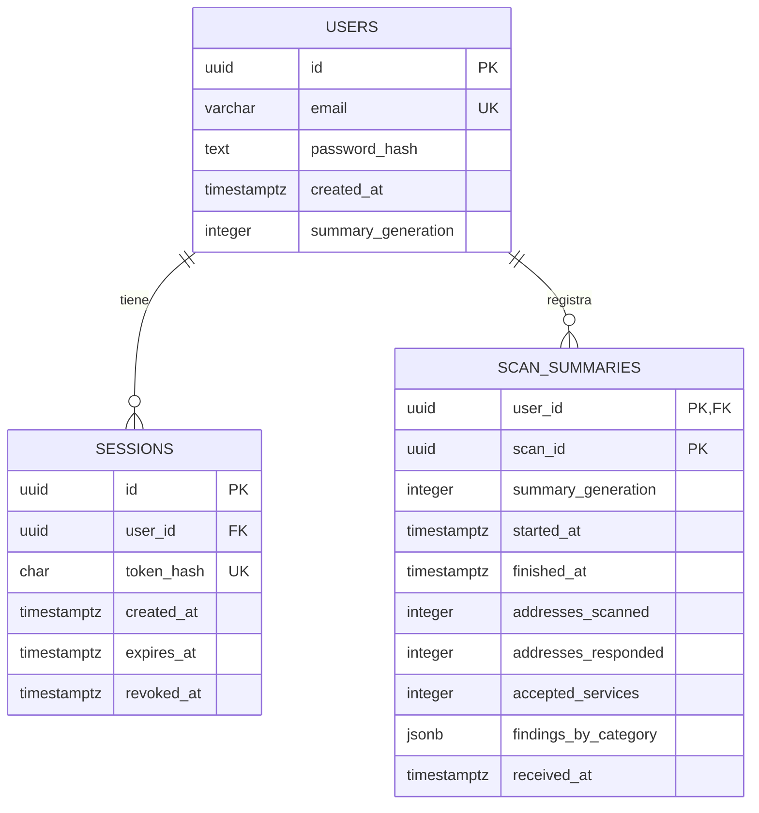

# Diseño del backend de HogarScan

Actualizado: 6 de noviembre de 2026.

## 1. Estado y fuente de referencia

El repositorio ya está inicializado con NestJS, TypeScript, Jest, Supertest,
Oxlint y Prettier. Contiene el arranque, el módulo raíz y el ejemplo
`Hello World!`; los módulos funcionales y PostgreSQL están pendientes.
La revisión corresponde a `main`, commit `d09b73b57285d23ac90f13229d9596b469f35015`.
Describe el estado observado, no acredita que las pruebas se hayan ejecutado.

El contrato de referencia es [hogarscan_openapi.yaml](./hogarscan_openapi.yaml),
OpenAPI **3.0.3**, versión **1.0.0-draft.2**. Las rutas, nombres JSON,
restricciones y respuestas se implementarán conforme a ese archivo.
Una modificación del contrato debe acordarse antes de integrar código dependiente.

## 2. Arquitectura acordada

Se utilizará un **monolito modular con arquitectura hexagonal**.
La API se ejecutará como una aplicación NestJS, organizada por funcionalidad.
Cada módulo separará negocio, casos de uso, transporte y adaptadores externos.

| Ubicación propuesta | Responsabilidad |
| --- | --- |
| `src/modules/auth/` | Cuentas y sesiones. |
| `src/modules/evaluations/` | Reglas, interpretación y fuentes NVD/KEV. |
| `src/modules/scan-summaries/` | Resúmenes, estadísticas y borrado remoto. |
| `src/config/` | Configuración tipada y validada al iniciar. |
| `src/shared/http/` | Formato común de errores y validaciones HTTP transversales. |
| `src/infrastructure/database/` | Conexión y soporte técnico de transacciones. |

Estas ubicaciones son el diseño previsto; no se presentan como carpetas existentes.
Se crearán cuando haya código que alojar. El acceso SQL específico estará
en el adaptador de persistencia del módulo correspondiente.

Dentro de cada módulo se utilizarán las siguientes responsabilidades:

| Capa | Contenido y dependencias |
| --- | --- |
| `domain` | Tipos, modelos y reglas de negocio; TypeScript independiente de NestJS, HTTP y PostgreSQL. |
| `application` | Casos de uso y puertos; depende del dominio y de interfaces propias. |
| `infrastructure` | Adaptadores de persistencia, criptografía y fuentes externas; implementa los puertos. |
| `presentation` | Controladores, DTO y mapeo entre HTTP y los casos de uso. |
| `<nombre>.module.ts` | Composición de NestJS: conecta puertos con adaptadores y exporta capacidades públicas. |

El dominio no importa las capas exteriores. Los casos de uso tampoco importan
NestJS, objetos Request/Response, clientes HTTP ni librerías de base de datos.
La inyección se configura desde los módulos mediante proveedores y fábricas.
Los controladores validan y traducen; los casos de uso coordinan; los adaptadores
realizan las operaciones técnicas. Los DTO HTTP no se convierten en el modelo de dominio.

Un módulo consume otro mediante una capacidad pública exportada.
No importa sus repositorios concretos ni utiliza sus tablas desde un controlador.
La identidad autenticada se obtiene de la sesión; no se elige con un `user_id` del cliente.
Los nombres concretos del guard, identidad autenticada y puertos compartidos
los publicará José al implementar la base; no deben duplicarse por anticipado.

## 3. Responsabilidades del equipo

| Área | Responsable |
| --- | --- |
| Base técnica, configuración, errores, seguridad HTTP e integración raíz | José Antonio Calvo Aguilar. |
| Toda la base de datos: diseño, tablas, restricciones, índices, scripts y migraciones | Exclusivamente José. |
| Conexión y adaptadores de persistencia | José. |
| Autenticación y sesiones | José. |
| Resúmenes, estadísticas, transacciones e idempotencia | José. |
| Reglas, evaluaciones y adaptadores NVD/KEV | Compañero: Uzzi Yazziel Gonzaga Gómez. |
| Revisión e integración de cambios | Ambos; José revisa e integra las entregas del compañero. |

El compañero no crea ni altera tablas, modelos ORM, migraciones, consultas SQL,
datos de prueba persistidos o repositorios de PostgreSQL. Si su funcionalidad
requiere persistencia, comunica el requisito y espera la implementación de José.
La herramienta de acceso a PostgreSQL está pendiente de elección por José.
La arquitectura no autoriza sincronización automática del esquema al arrancar.

## 4. Operaciones y límites funcionales

| Operación | Módulo | Acceso | Responsable |
| --- | --- | --- | --- |
| `POST /auth/register` | `auth` | Público | José |
| `POST /auth/login` | `auth` | Público | José |
| `GET /auth/me` | `auth` | Sesión vigente | José |
| `POST /auth/logout` | `auth` | Sesión vigente | José |
| `GET /rules` | `evaluations` | Público | Compañero |
| `POST /evaluations` | `evaluations` | Sesión vigente | Compañero |
| `POST /me/scans` | `scan-summaries` | Sesión vigente | José |
| `GET /me/stats` | `scan-summaries` | Sesión vigente | José |
| `DELETE /me/scans` | `scan-summaries` | Sesión vigente | José |

`GET /rules` y las evaluaciones comparten una fuente de reglas versionada.
Las estadísticas pertenecen al módulo de resúmenes; el motor de evaluación
no guarda resúmenes ni actualiza los agregados de una cuenta.
No se añaden rutas de inventario remoto ni historial detallado de dispositivos.

## 5. Seguridad y transporte

La API publicada se consumirá por **HTTPS**, con certificado TLS válido.
La terminación TLS y el despliegue se configurarán de forma coordinada;
el término controlador HTTP también aplica al tráfico recibido mediante HTTPS.
Las pruebas locales aisladas pueden utilizar el servidor de pruebas del framework.

- Contraseñas de registro: 15–128 puntos de código Unicode; login: 1–128.
- No se recortan, normalizan ni truncan las contraseñas; se permiten espacios.
- Hash Argon2id con salt aleatorio. Los parámetros se medirán y documentarán al implementarlo.
- Tokens opacos: 32 bytes CSPRNG, base64url sin relleno; no son JWT ni OAuth2.
- Se conserva SHA-256 del token, su vencimiento y revocación; nunca el token en claro.
- La vigencia inicial prevista de sesión es siete días configurables; el cliente usa `expires_at`.
- El registro no inicia sesión y `GET /auth/me` no vuelve a entregar el token.
- El token se envía en `Authorization: Bearer`, nunca en una URL.
- Un login fallido utiliza respuesta genérica. Una sesión vencida o revocada pierde acceso remoto.
- Las operaciones locales del móvil no dependen de renovar una sesión remota.
- Un logout sin conexión no acredita revocación remota.
- Se implementarán límites de solicitudes y respuestas privadas con `Cache-Control: no-store`.
- No se registran contraseñas, tokens, claves externas ni cuerpos completos de observaciones.

Cada cuerpo JSON admite como máximo **16384 bytes UTF-8**, antes de parsearlo.
Se rechazan propiedades adicionales, tipos incorrectos, claves JSON duplicadas
y cuerpos comprimidos. Los errores conservan `code`, `message` y `details`
cuando corresponda; no exponen SQL, trazas ni secretos. El contrato incluye 413,
415, 429, 500 y 503 donde procede. La base técnica debe comprobar esas garantías:
un DTO o una tubería por sí solos no resuelven todas las restricciones de entrada.

## 6. Evaluación de observaciones

Android ejecuta TCP únicamente en la subred autorizada; la API no conecta a la LAN.
Room conserva direcciones, alcance, intentos e historial detallado.
Una solicitud evalúa las observaciones de una dirección sin enviar esa IP,
un identificador del dispositivo, banners o respuestas completas de servicios.
La evaluación no se persiste como inventario remoto en PostgreSQL.

| Android | Nombre JSON de la API |
| --- | --- |
| `ACCEPTED` | `ACCEPTED` |
| `REJECTED` | `REFUSED` |
| `TIMED_OUT` | `TIMEOUT` |
| `ERROR` | `ERROR` |

El piloto admite hasta seis puertos distintos: 22, 23, 80, 443, 445 y 3389.
Una conexión aceptada no demuestra vulnerabilidad; un timeout no confirma ausencia.
El número de puerto no identifica por sí solo un protocolo.

`protocol` y `evidence_kind` se omiten juntos o se declaran juntos con `ACCEPTED`:

| Protocolo | Evidencia permitida |
| --- | --- |
| HTTP | `HTTP_RESPONSE` |
| HTTPS | `HTTPS_RESPONSE`: respuesta HTTP sobre TLS. |
| SSH | `SSH_IDENTIFICATION` |
| FTP | `FTP_GREETING` |

Un handshake TLS aislado no se declara como HTTPS. El móvil actual puede omitir
ambos campos: su revisión TCP no obtiene automáticamente esa evidencia.

Las cinco categorías son `TCP_SERVICE_ACCESSIBLE`, `PROTOCOL_IDENTIFIED`,
`PREVENTIVE_REVIEW`, `POSSIBLE_CVE_MATCH` e `INSUFFICIENT_EVIDENCE`.
Cada hallazgo incluye evidencia, explicación, acción, limitación, regla y confianza.
La combinación concreta de prioridad, confianza y regla se documenta y prueba
antes de integrarse; no se inventan niveles de certeza a partir de un puerto.

La identificación manual exige fabricante, producto, versión y procedencia;
continúa siendo información declarada. Una búsqueda textual solo aporta candidatos.
Para emitir una posible CVE deben comprobarse producto, versión y condiciones
de afectación publicadas. Si no pueden resolverse, se declara la limitación.
CISA KEV prioriza CVE sustentadas; no identifica el producto ni confirma que el
equipo particular sea vulnerable. La ausencia de una CVE en KEV no significa seguridad.

Se conserva la evaluación básica si una fuente falla. Los estados son
`NOT_QUERIED`, `AVAILABLE` y `UNAVAILABLE`; `checked_at` es nulo cuando no se
intentó ninguna consulta. Una caché conserva su fecha real de comprobación.
Sin coincidencias, KEV permanece `NOT_QUERIED`. Con coincidencias se exige NVD
disponible; `in_kev` es booleano solo con KEV disponible y nulo en otro caso.
Cada CVE de los hallazgos corresponde a una coincidencia y viceversa, sin duplicados.
El fallo externo no se convierte automáticamente en 503 si aún es posible la evaluación básica.

## 7. Modelo previsto de PostgreSQL

El siguiente modelo es una referencia lógica pendiente de implementar por José.
Los tipos y restricciones definitivos se conservarán en sus scripts de base de datos.

El email se valida y usa minúsculas consistentemente para búsqueda y unicidad;
el máximo es 254 caracteres. El hash de token SHA-256 puede almacenarse como
hexadecimal de 64 caracteres. `summary_generation` inicia en cero.
La clave de los resúmenes es `(user_id, scan_id)`; no se conservan IP privadas,
redes, nombres de dispositivos ni resultados TCP individuales en estas tablas.

## 8. Resúmenes, estadísticas y borrado

Solo se sincronizan revisiones completas y evaluadas. Se excluyen las canceladas,
interrumpidas, parciales o con evaluación pendiente. El contenido se congela.
El servidor valida coherencia, pero no certifica que el móvil ejecutara la revisión.

- `addresses_scanned`: 1–254 objetivos autorizados, excluido el teléfono.
- `addresses_responded`: direcciones con al menos una aceptación o rechazo; no supera `addresses_scanned`.
- `accepted_services`: pares dirección/puerto aceptados distintos; máximo 1524 y no supera `addresses_responded * 6`.
- Las categorías cuentan hallazgos y no equivalen necesariamente a equipos o servicios.
- Los agregados no reutilizan el máximo de hallazgos por revisión.
- Los totales, generación y últimas diez revisiones se leen desde una instantánea consistente.
- La serie se ordena por `started_at` descendente y `scan_id` ascendente para desempatar.

Las fechas JSON son RFC3339 UTC con `Z`, hasta milisegundos. Se validan como fechas.
`finished_at` puede preceder a `started_at` si cambió el reloj del móvil; no se
alteran las fechas ni se calcula duración mediante su resta. `received_at` es del servidor.

La API comprueba primero la generación y compara contenido canónico validado:
UUID en minúsculas, fechas normalizadas y orden de claves irrelevante.
Un resumen idéntico devuelve 200 y `created=false`, con el recibo original;
uno nuevo devuelve 201 y `created=true`; mismo ID con otros datos devuelve 409.
La generación anterior o futura se rechaza y se informa la generación vigente.
No se cambia la generación de un resumen congelado para intentar reenviarlo.

`DELETE /me/scans` exige el parámetro query `summary_generation` conocido al
confirmar el borrado. Una transacción bloquea la cuenta, comprueba la generación,
borra los resúmenes y la incrementa, incluso sin filas. Una generación anterior
devuelve 409 sin volver a borrar: un reintento no elimina datos de una generación nueva.
El cliente no sustituye la generación para repetir automáticamente la intención anterior.
El borrado remoto es independiente del historial Room.

## 9. Trabajo paralelo y condiciones de espera

| Si falta o cambia… | El compañero debe esperar a José para… | Puede avanzar mientras tanto en… |
| --- | --- | --- |
| Base, configuración y errores comunes | Integrar cambios transversales o alterar el arranque. | Diseño del módulo y pruebas puras. |
| Guard e identidad de sesión públicos | Exponer o integrar `POST /evaluations` protegido. | Motor y pruebas con dobles aislados. |
| Registro de módulos en `AppModule` | Modificar la composición raíz. | Entrega del módulo con instrucciones de integración. |
| Nueva dependencia o variable de entorno | Cambiar manifiestos, lockfile o configuración común. | Puerto y pruebas del adaptador. |
| Cambio de contrato, categorías o semántica de hallazgos | Integrar cambios que afecten DTO, móvil o conteos. | Propuesta documentada y pruebas de la alternativa. |
| Persistencia o nuevas tablas | Cualquier cambio de base de datos o repositorio PostgreSQL. | Lógica sin persistencia y requisito técnico. |
| Integración entre evaluación y resúmenes | Alterar congelación, sincronización o estadísticas. | Respuesta de evaluación conforme al contrato. |

La existencia de una rama o promesa de implementación no habilita una dependencia.
Debe estar integrada y comprobada en `main`, o existir un acuerdo explícito sobre
una rama de integración temporal. Un doble de prueba nunca sustituye la seguridad de producción.
Se pausa la parte afectada, se avisa a José y se continúa con trabajo independiente.

## 10. Ramas, commits y revisión

Se utilizará `main` como base integrada y ramas cortas por cambio concreto:
`chore/api-config`, `feat/auth-register`, `feat/evaluation-domain` o `feat/rules-endpoint`.
Antes de crear una rama: conservar cambios locales, actualizar `main` con
`git pull --ff-only origin main` y crear la rama desde esa base.

Cada commit tendrá una responsabilidad verificable. Evitar cambios de más de
1000 líneas; si se aproxima ese tamaño, dividir el trabajo por avances lógicos.
Las dependencias y cambios generados se coordinan, no se ocultan ni editan a mano.
No mezclar refactorizaciones globales o formateo ajeno con una funcionalidad.

El compañero abre una pull request hacia `main`, explica comportamiento,
pruebas y bloqueos, y solicita revisión de José. Una entrega bloqueada permanece
en borrador. No se integra código con dependencias ficticias o controles omitidos.
La protección de rama es una configuración pendiente de comprobar; estas reglas
de colaboración aplican aunque todavía no esté configurada en GitHub.

Para actualizar una rama de trabajo se utiliza `git fetch origin` y
`git merge origin/main`, revisando los conflictos. No se fuerza el push ni se
descartan cambios de otro integrante; un conflicto semántico se resuelve con José.
Se preservan los commits lógicos al integrar; no se agrupan en un commit masivo.

Antes de solicitar integración: `npm run build`, `npm run lint`,
`npm test -- --runInBand` y `npm run test:e2e -- --runInBand`.
Las pruebas normales usan respuestas externas controladas; una consulta real
opcional no sustituye las pruebas reproducibles. Se conserva el contrato vigente.

## 11. Orden de implementación y cierre

1. José documenta arquitectura y deja configuración, errores y validaciones comunes.
2. José prepara PostgreSQL y su acceso; el compañero avanza tipos y motor aislado.
3. José implementa autenticación, guard e identidad pública de sesión.
4. El compañero integra `/rules` y después `/evaluations` cuando estén listas sus dependencias.
5. José implementa resúmenes y estadísticas; el compañero completa NVD/KEV por entregas pequeñas.
6. Ambos revisan pruebas, contrato, límites, fallos externos e integración por cuenta.

El bloque de autenticación cierra al verificar registro, login, `/auth/me`,
rechazo de tokens inválidos/vencidos/revocados y logout efectivo.
El bloque de evaluación cierra con reglas trazables, respuesta conforme al
contrato, manejo de evidencia insuficiente y degradación honesta de fuentes.
El de resúmenes cierra con aislamiento por usuario, reintentos idempotentes,
conteos coherentes y borrado seguro ante concurrencia y pérdida de respuesta.

El móvil conserva `scan_records`, `scan_ports` y `probe_results` en Room.
La asociación del perfil `local:<UUID>` a una cuenta y los cambios móviles
pendientes se tratarán al retomar ese frente; no se reasigna historial automáticamente.

## Referencias

- [Contrato OpenAPI del proyecto](./hogarscan_openapi.yaml).
- [Arquitectura móvil](https://github.com/jacalvoag/HogarScan-Mobile/blob/main/docs/arquitectura.md).
- [Módulos NestJS](https://docs.nestjs.com/modules).
- [Proveedores personalizados NestJS](https://docs.nestjs.com/fundamentals/custom-providers).
- [Ramas y colaboración en GitHub](https://docs.github.com/en/pull-requests/reference/branches).
- [OWASP: contraseñas](https://cheatsheetseries.owasp.org/cheatsheets/Password_Storage_Cheat_Sheet.html).
- [OWASP: sesiones](https://cheatsheetseries.owasp.org/cheatsheets/Session_Management_Cheat_Sheet.html).
- [NVD: configuraciones afectadas](https://nvd.nist.gov/vuln/Vulnerability-Detail-Pages).
- [CISA: catálogo KEV](https://www.cisa.gov/known-exploited-vulnerabilities-catalog).
